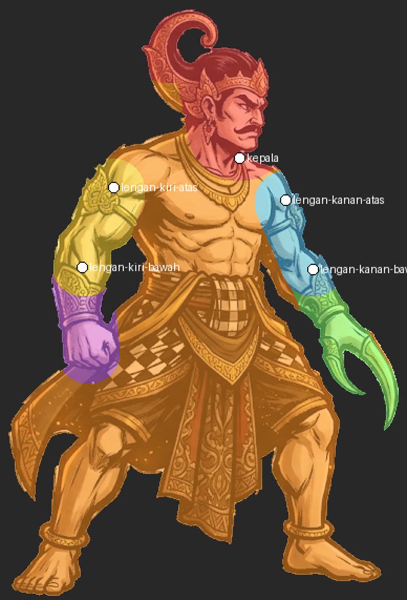
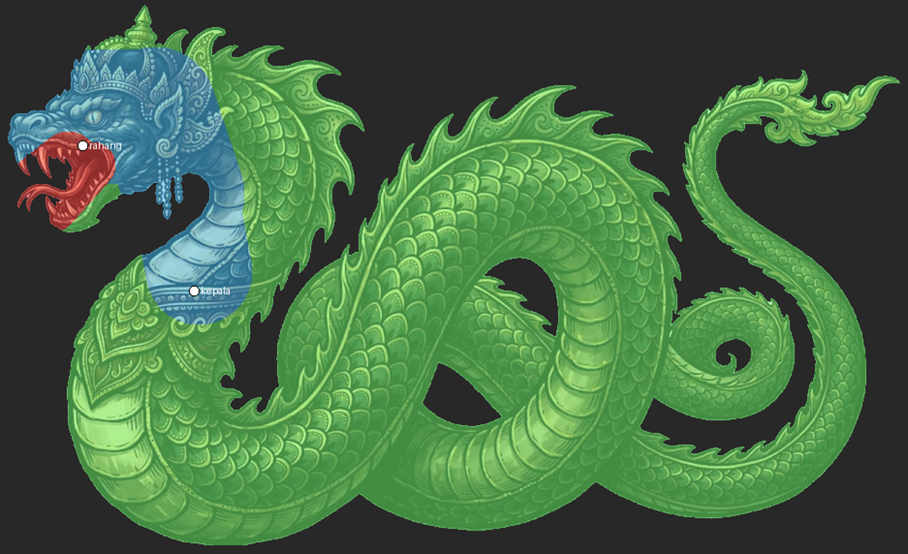

# Panduan Aset "Wayang Potongan" — Lakon Dewa Ruci

Tujuan: setiap tokoh dipecah menjadi beberapa bagian (kepala, badan, lengan, dan seterusnya) supaya bisa digerakkan per sendi seperti wayang kulit asli. Dengan begitu tokoh tidak lagi kaku, dan gerakan menunjuk, menebas, atau menoleh bisa dibuat penuh tanpa gambar "meleleh".

**Sudah diuji:** potongan Bima yang saya buat dari gambar lama berhasil digerakkan. Contohnya ada di `docs/aset-panduan/bima-contoh-pose.png`: lengan cakar bisa diangkat setinggi kepala. Kekurangannya, potongan otomatis itu meninggalkan **lubang** di bahu, leher, dan badan yang tadinya tertutup lengan. Lubang inilah yang perlu ditambal oleh AI.

---

## Strategi: jangan buat ulang tokoh, cukup "lengkapi" gambar yang ada

Kesalahan yang paling sering terjadi: meminta AI menggambar ulang tokoh dari nol. Wajah dan kostumnya akan berubah, lalu potongannya tidak cocok lagi dengan gambar asli.

Yang benar: **gambar asli tetap dipakai.** AI hanya diminta untuk:
1. **Membuat versi badan tanpa lengan dan kepala**, dengan bahu dan leher yang utuh. Ini satu-satunya bagian yang benar-benar harus digambar AI.
2. **Melengkapi ujung tiap bagian yang terpotong**, misalnya pangkal lengan atas yang tadinya tersembunyi di balik bahu.

Kepala, lengan bawah, dan cakar bisa langsung dipotong dari gambar asli di Photopea, karena bagian-bagian itu tidak tertutup apa pun.

---

## Alat yang direkomendasikan

| Urutan | Alat | Dipakai untuk |
|---|---|---|
| 1 | **Gemini (Nano Banana / image editing)** | Membuat **badan tanpa lengan** dan **menambal bahu/leher**. Paling kuat menjaga wajah dan kostum tetap sama dengan gambar referensi |
| 2 | **Photopea** (gratis, di browser) | Memotong bagian dari gambar asli, menyusun ulang di kanvas yang benar, lalu ekspor PNG transparan |
| 3 | **ChatGPT image** | Cadangan kalau Gemini terus mengubah detail; bisa langsung menghasilkan latar transparan |
| 4 | **remove.bg / Photopea "Remove BG"** | Menghapus latar putih dari hasil AI |

**Claude (saya) tidak bisa membuat gambar.** Tugas saya menyiapkan panduan ini, mengecek hasilnya, lalu merangkai potongan menjadi gerakan di website.

---

## Template gaya (tempel di awal setiap prompt Gemini)

```
You are editing the attached illustration. Keep EVERYTHING identical to the original:
same character, same face, same costume, same gold ornaments, same colors, same heavy
black ink line art and cel shading, same lighting, same scale and same position on the canvas.
Do not redraw, restyle, or move anything that is not mentioned below.
Background: plain pure white (#FFFFFF), no shadow, no text, no border.
```

---

## 1. Sang Bima · PRIORITAS 1
Referensi: `public/images/stories/dewa-ruci/char-bima.png` (388×571 px)
Gambar panduan potong: `docs/aset-panduan/bima-panduan.png`



| File hasil | Bagian | Cara membuat | Titik sendi (x, y) |
|---|---|---|---|
| `bima-badan.png` | badan, kain, dan kaki **tanpa kepala dan tanpa kedua lengan** | **Gemini** (prompt B1) | pinggang (215, 320) |
| `bima-kepala.png` | kepala, mahkota, gelung, dan leher | potong dari gambar asli (area merah), lalu **Gemini** untuk melengkapi leher bawah (prompt B2) | leher (228, 150) |
| `bima-lengan-kanan-atas.png` | lengan kanan (sisi kanan gambar), bahu sampai siku | potong (area biru), lalu **Gemini** untuk melengkapi bahu (prompt B3) | bahu (272, 190) |
| `bima-lengan-kanan-bawah.png` | lengan bawah, tangan, dan Kuku Pancanaka | potong dari gambar asli (area hijau) | siku (298, 256) |
| `bima-lengan-kiri-atas.png` | lengan kiri, bahu sampai siku | potong (area kuning), lalu **Gemini** untuk melengkapi bahu (prompt B3) | bahu (108, 178) |
| `bima-lengan-kiri-bawah.png` | lengan bawah kiri dan kepalan tangan | potong dari gambar asli (area ungu) | siku (78, 254) |

**Prompt B1 (badan tanpa lengan dan kepala):**
```
[template gaya]
Remove the head (including crown, hair bun and neck) and remove BOTH arms completely
(upper arms, forearms, hands and the golden claw).
Then repaint what was hidden: draw complete, rounded, muscular SHOULDERS where the arms were attached,
draw the full chest and torso sides that were behind the arms, and end the neck with a short clean
stump at the collar line with the gold necklace still visible.
Keep the torso, waist cloth, belt, legs and feet exactly the same and in exactly the same place.
```

**Prompt B2 (melengkapi leher pada potongan kepala):**
```
[template gaya]
This is only the head of the character. Extend the bottom of the neck downward by about 40 pixels
with matching skin tone and shading so the neck ends in a clean rounded edge.
Do not change the face, crown or hair.
```

**Prompt B3 (melengkapi bahu pada potongan lengan atas):**
```
[template gaya]
This is only the upper arm of the character. Complete the top end into a full rounded shoulder
(deltoid muscle) as if the arm was detached from the body, with matching skin tone and line art.
Keep the gold armband and the rest of the arm unchanged.
```

---

## 2. Naga Nemburnawa · PRIORITAS 2
Referensi: `public/images/stories/dewa-ruci/char-naga.png` (937×572 px)
Gambar panduan potong: `docs/aset-panduan/naga-panduan.png`



| File hasil | Bagian | Cara membuat | Titik sendi (x, y) |
|---|---|---|---|
| `naga-badan.png` | tubuh melingkar dan ekor **tanpa kepala dan leher atas** | **Gemini** (prompt N1) | — |
| `naga-kepala.png` | kepala, mahkota, rahang atas, dan leher (area biru) **dengan mulut tertutup rapat** | **Gemini** (prompt N2) | leher (200, 300) |
| `naga-rahang.png` | rahang bawah, gigi bawah, dan lidah (area merah) | **Gemini** (prompt N3) | engsel rahang (85, 150) |

**Prompt N1 (badan tanpa kepala):**
```
[template gaya]
Remove the dragon's head, crown, jaw and the upper part of the neck (everything above the ornate gold collar).
End the body cleanly at the gold collar with a smooth rounded neck stump covered in matching scales.
Keep the coiled body, belly scales, spikes and the tail exactly the same and in exactly the same place.
```

**Prompt N2 (kepala dengan mulut tertutup):**
```
[template gaya]
Show ONLY the dragon's head with its crown and the upper neck down to the gold collar.
Remove the lower jaw and tongue. Close the mouth area so the upper jaw ends in a clean edge with
the upper teeth visible, and paint a dark red mouth interior behind where the lower jaw was.
Keep the same angle, size and position as in the original.
```

**Prompt N3 (rahang bawah):**
```
[template gaya]
Show ONLY the dragon's lower jaw: lower teeth, fangs and the forked tongue, as a separate piece.
Complete the hinge end (near the back of the mouth) into a clean rounded edge.
Keep the same size and angle as in the original image.
```

---

## 3. Resi Drona · PRIORITAS 3
Referensi: `char-durna.png` (435×562 px)

| File hasil | Bagian | Cara membuat | Titik sendi (x, y) |
|---|---|---|---|
| `drona-badan.png` | badan dan jubah tanpa kepala dan tanpa lengan kanan pemegang tongkat | Gemini | — |
| `drona-kepala.png` | kepala, mahkota, dan janggut | potong + lengkapi leher | leher (190, 165) |
| `drona-lengan-tongkat.png` | lengan kanan dan tongkat | potong + lengkapi bahu | bahu (300, 190) |
| `drona-tangan-tunjuk.png` | lengan kiri menunjuk ke depan | Gemini (pose baru) | bahu (140, 190) |

## 4. Dewa Ruci · PRIORITAS 4
Referensi: `char-dewa-ruci.png` (208×505 px)

| File hasil | Bagian | Cara membuat | Titik sendi (x, y) |
|---|---|---|---|
| `dewaruci-badan.png` | badan tanpa lengan kanan | Gemini | — |
| `dewaruci-lengan.png` | lengan kanan memberi isyarat (telapak terbuka) | Gemini (pose baru) | bahu (155, 172) |

> Kalau waktu terbatas, cukup kerjakan **Bima dan Naga**. Kedua tokoh ini sudah mencakup sebagian besar adegan aksi.

---

## Langkah menyusun di Photopea (wajib, supaya sendinya pas)

1. Buka gambar asli (misalnya `char-bima.png`) di Photopea. Ukuran kanvasnya adalah ukuran acuan.
2. Seret hasil Gemini ke atas sebagai layer baru. Atur opacity 50%, lalu geser dan ubah ukurannya sampai **tepat menimpa** gambar asli. Kembalikan opacity ke 100%.
3. Hapus latar putih (*Select → Remove BG* atau Magic Wand).
4. **Satu bagian = satu layer.** Bagian yang tidak perlu dihapus dari layer tersebut.
5. Ekspor setiap layer: *File → Export Layers*, atau sembunyikan layer lain lalu *Export as PNG*. **Ukuran kanvas jangan diubah** (Bima tetap 388×571, naga 937×572).
6. Simpan di `public/images/stories/dewa-ruci/parts/` dengan nama sesuai tabel.

**Cara cek cepat:** kalau semua layer bagian dinyalakan bersamaan, hasilnya harus terlihat **sama persis dengan gambar asli**, tanpa celah dan tanpa bagian dobel.

---

## Setelah file siap
Taruh file di folder di atas lalu beri tahu saya. Saya akan:
1. Mengecek apakah setiap bagian pas dengan titik sendinya. Ada skrip otomatis yang menyusun ulang semua bagian dan membandingkannya dengan gambar asli.
2. Mengganti tokoh gambar-utuh di pentas dengan tokoh berpotongan.
3. Membuat gerakan penuh: Bima menebas dan menoleh, naga menyambar dengan rahang terpisah, Drona menunjuk, Dewa Ruci memberi isyarat.
